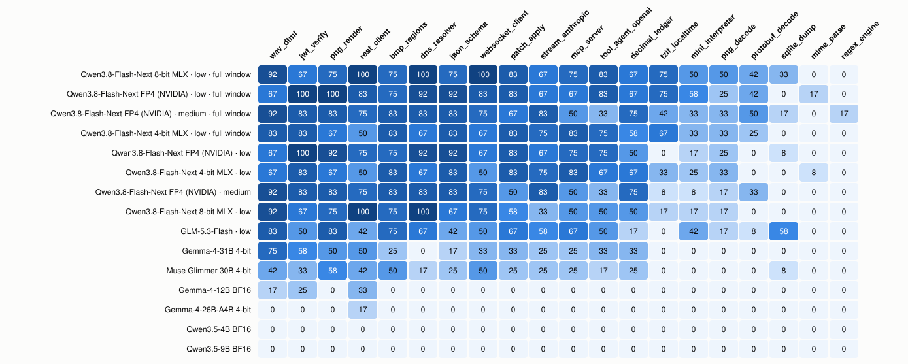
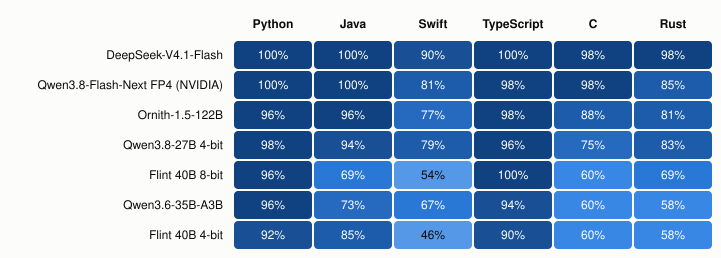
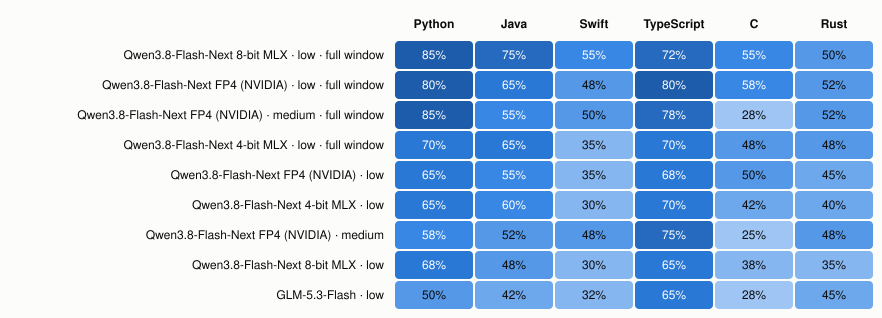

# languages-benchmark: can a model write a working program in six languages?

*An open-source project from [Incept5 (i5)](https://incept5.ai). More from us: **[github.com/Incept5-AI](https://github.com/Incept5-AI)**.*

Two coding benchmarks for LLMs. Each one gives the model a precise spec and asks for one complete program in
**Python, Java, Swift, TypeScript, C and Rust**. The harness builds the program, runs it and compares what it prints
with the expected output.

| Suite | Tests | What it covers |
|---|---|---|
| **v1** | 8 challenges × 6 languages = **48** | Everyday programs: JSON deep merge, CSV report, log parsing, an HTTP client, Dijkstra, a file-tree walk, running system commands, matrix arithmetic. Strong local models now score 42–47, so v1 mostly separates mid-sized models. |
| **v2** | 20 challenges × 6 languages = **120** | Real specs and protocols: OAuth + pagination, WebSocket and DNS clients, an OpenAI tool-calling loop, Anthropic SSE streaming, an MCP server, PNG/BMP/WAV/TZif/protobuf/SQLite parsing, JWT, JSON Schema, MIME, decimal arithmetic, a regex engine, an interpreter, patch application. Each program also runs on 2 hidden cases with different data. Good local models score 44–65% at a 32k cap. |

Models are reached through any **OpenAI-compatible `/v1/chat/completions` endpoint** (vLLM, SGLang, llama.cpp,
LM Studio, Ollama, mlx-lm/mlx-vlm servers, oMLX, TabbyAPI, OpenRouter …). The harness is Python standard library only.

**Every one of the 168 cells has a reference solution** (`python3 bench.py verify` grades them all in about 20 s).
So every test is known to be solvable exactly as the model sees it. See [Reference solutions](#reference-solutions).



## Quick start

You need the six toolchains on the machine that grades (the model can be anywhere):

| Language | What the harness runs | Install (macOS) |
|---|---|---|
| Python | `python3` | 3.10 or newer |
| Java | `javac` / `java` 21+ | `brew install openjdk@21` (found automatically), or set `LB_JAVA_BIN` |
| Swift | `swift`, `swiftc` | Xcode or the Command Line Tools |
| TypeScript | `npx tsx` | `brew install node && npm i -g tsx` |
| C | `cc` | Xcode Command Line Tools |
| Rust | `rustc` | [rustup](https://rustup.rs) |

```bash
git clone https://github.com/Incept5-AI/languages-benchmark && cd languages-benchmark
python3 bench.py doctor          # checks the six toolchains
python3 bench.py verify          # grades all 168 reference solutions; should print 48/48 and 120/120

# Run both suites against a local server (vLLM, llama.cpp, LM Studio, …)
python3 bench.py run --base-url http://localhost:8000/v1 --model my-model --effort medium

# Three runs of v1 (it's noisy; see below), no reasoning, 8 tests in flight
python3 bench.py run --suite v1 --model my-model --no-thinking --runs 3 --workers 8

# A hosted API: the key comes from LB_API_KEY or OPENAI_API_KEY
LB_API_KEY=sk-... python3 bench.py run --base-url https://openrouter.ai/api/v1 --model <provider/model-id>

python3 bench.py report results/*.json                    # leaderboard, per language, per challenge
python3 bench.py html results/*.json -o report.html       # the same with heat maps, as one HTML file
```

macOS on Apple Silicon is the reference platform: v2's prompts tell the model it runs on macOS arm64, and some v2
tasks allow macOS frameworks (CommonCrypto, Foundation, SQLite3). Other platforms are untested.

## The token cap (`--max-tokens`, default 32k)

Each request carries `max_tokens = 32768` by default. Reasoning models spend most of that thinking, and a model that
runs out inside its reasoning returns **an empty answer, which scores as a fail**. "Capped" in every report counts
those attempts, so you can tell "wrong" from "ran out".

- `--max-tokens 65536` (or any number) changes the cap. Give every model you compare the same cap.
- `--max-tokens 0` sends no cap at all, so the server's own limit (usually the context window) applies.
- The 32k default keeps a run bounded in time. The v2 examples below show what it costs: re-running only the capped
  tests at the full window raised scores by 5.5–22 points out of 120.

## The loop guard (on by default since 1.1.0)

Some reasoning models fall into a repetition loop and keep going until the cap: the same line of code, or the same
paragraph of "Wait, let me reconsider", thousands of times. Nothing that comes out of a loop can pass, and at a large
cap one looping attempt can take hours. So every request is **streamed** and watched as it arrives
(`langbench/loopguard.py`). When the last 24,000 characters of the reasoning or the reply compress to under 5% of
their size *and* end in one block repeated back to back at least 8 times (or compress under 2%), five checks in a
row, 2,000 characters apart, the attempt is cut. A loop therefore has to persist for about 32,000 characters
(roughly 8–10k tokens) before anything happens.

- A cut attempt is recorded with `finish_reason: "loop"`, stage `loop` and a `loop` object (where it was caught, the
  repeating unit, a sample), and **the test fails at once, with no retry**. "Looped" in every report counts them.
- Closing the stream makes vLLM, llama.cpp and mlx-vlm cancel the generation, so the server slot is freed too.
- Calibration (2026-10-25, 1,861 stored replies, 478 long enough to check): it fired on three, all failed and all
  degenerate, and never on a reply that passed. Normal prose and code compress to about 0.25–0.45, and the closest
  normal text we have seen to 0.085; loops compress to 0.002–0.02.
- `--no-loop-guard` restores the 1.0.0 behaviour exactly (one non-streamed request per attempt). Results written
  before 1.1.0 have no `loop_guard` field, so resuming one needs `--no-loop-guard`.

## What a test is, and how it is scored

1. The model gets **one user message** with the task and a short contract for how its program is built and run (`python3 bench.py prompt <challenge> <lang>` prints it). It gets no system prompt and no tools. The prompt is the same for every model.
2. The harness takes the code block from the reply, builds it and runs it. v1 checks stdout against one expected output. v2 runs the program on the worked example **and on 2 hidden cases** with different data, and all must pass.
3. On failure the model gets **one retry**: a fresh single-turn prompt with its program and the grader's feedback (the compiler error, the crash, or where the output differs). No reasoning is replayed.
4. **Score: 1.0 if the first try passes, 0.5 if the retry passes, 0 otherwise.** Request errors and timeouts score 0 and stay in the denominator. Leaving them out would quietly favour the models that time out on the hardest items.

Only wire-level settings differ between models: `reasoning_effort` (`--effort`), `chat_template_kwargs.enable_thinking`
(`--no-thinking`), the cap, and sampling. The default sampling is the Qwen coding preset (thinking 0.6 / 0.95 / top-k 20;
no-thinking 0.7 / 0.8 / top-k 20, presence penalty 1.5), which every example below used. Override it with
`--temperature`, `--top-p`, `--top-k` and `--presence-penalty`, or add anything to the request body with `--extra-body '{"seed": 1}'`.

Every result file stores each attempt's code, token counts, timing, finish reason and grader feedback. Full replies
are stored too unless you pass `--no-replies`. The file is rewritten after every test. **If a run stops, run the same
command again and it resumes**; tests that failed only on request errors (a server restart, a dropped tunnel) are
retried. `--fresh` starts over.

### Run it more than once

v1 scores move by 1–6 points out of 48 between runs at temperature 0.6, larger than many gaps between
models. Use `--runs 3`; reports show the mean and range. To compare two runs on the same tests, `report A.json B.json --pair` gives an exact McNemar test on first-try passes.

## Example results

These come from Incept5's own runs (October 2026), on the prompts and graders in this repo, imported with hostnames
and paths removed. They are in [`results/examples/`](results/examples) with every program the models wrote. The
full report with heat maps is **[docs/example-report.html](https://incept5-ai.github.io/languages-benchmark/docs/example-report.html)**.
Rebuild it with:

```bash
python3 bench.py html results/examples/*/*.json -o docs/example-report.html --svg-dir docs/img
```

The models ran on different hardware and engines, so **minutes per run are a property of the setup, not the
model.** Read them as "what this took on that box". Effort was `medium` for v1 and as shown for v2.

### v1 · 48 tests (three runs each unless marked)

| Model | Engine · hardware | Cap | Score (range) | 1st try | Capped | Looped | Min/run |
|---|---|---:|---:|---:|---:|---:|---:|
| DeepSeek-V4.1-Flash | EXL3 2.9 bpw, TensorFold TP=2 · 2× DGX Spark | 64k | **46.8** (46.5–47.5) | 46.0 | 0.7 | – | 71 |
| Qwen3.8-Flash-Next FP4 (NVIDIA) | NVFP4, vLLM · DGX Spark | 64k | **45.0** (44.5–45.5) | 43.3 | 0 | – | 14 |
| Ornith-1.5-122B | EXL3 4 bpw, TabbyAPI + MTP · DGX Spark | 32k | **42.8** (40.5–44) | 40.0 | 1.3 | – | 162 |
| Gemma-4-31B 4-bit | MLX, oMLX · Mac Studio M5 Ultra | 32k | **42.5** (42–43) | 39.7 | 0 | 0 | 46 |
| Qwen3.8-27B 4-bit | MLX, Splash · Mac Studio M5 Ultra | 32k | **42.0** (41.5–43) | 39.0 | 0 | – | 7 |
| Muse Glimmer 30B 4-bit | MLX, oMLX · Mac Studio M5 Ultra | 32k | **38.5** (36.5–40) | 34.0 | 0.3 | 0 | 17 |
| Gemma-4-12B BF16 | MLX, oMLX · Mac Studio M5 Ultra | 32k | **37.5** (35.5–38.5) | 34.0 | 0.3 | 1.3 | 54 |
| Flint 40B 8-bit | MLX, mlx-vlm · Mac Studio M5 Ultra | 32k | **35.8** (32.5–38.5) | 32.3 | 0 | – | 40 |
| Qwen3.6-35B-A3B | 4-bit, vLLM · DGX Spark | 32k | **35.8** (34–37) | 32.0 | 8.7 | – | 60 |
| Flint 40B 4-bit | MLX int4, mlx-vlm · Mac Studio M5 Ultra | 32k | **34.5** (33.5–36) | 28.3 | 0.7 | – | 36 |
| Gemma-4-26B-A4B 4-bit | MLX, oMLX · Mac Studio M5 Ultra | 32k | **27.8** (26.5–29) | 25.3 | 3.3 | 5.3 | 45 |
| Nanbeige4.3-33B 4-bit (one run) | MLX, oMLX · Mac Studio M5 Ultra | 32k | **22.5** | 20.0 | 16 | 0 | 419 |
| Gemma-4-12B 4-bit (one run) | MLX, oMLX · Mac Studio M5 Ultra | 32k | **17.5** | 15.0 | 7 | 24 | 81 |
| Qwen3.5-9B BF16 | MLX, oMLX · Mac Studio M5 Ultra | 32k | **16.8** (16–18) | 15.0 | 1.7 | 19.3 | 73 |
| Qwen3.5-4B BF16 | MLX, oMLX · Mac Studio M5 Ultra | 32k | **8.7** (7–10) | 7.3 | 1.3 | 31.0 | 71 |

"Looped" counts attempts the loop guard cut (1.1.0); the earlier rows were run before it existed. The rows run on oMLX
(October 2026) used thinking on, the default sampling and the 32k cap. Gemma-4 needs
`--extra-body '{"chat_template_kwargs":{"enable_thinking":true}}'` because its template defaults to thinking off.
Muse Glimmer ran at `reasoning_strength` medium (its default is high); the Qwen3.5 and Gemma models have no effort
setting. Gemma-4-31B's minutes are from its first two runs; the third was interrupted by a network outage and resumed.

- **Quantization can halve a small model's score.** Gemma-4-12B scored 37.5 in BF16 and 17.5 at 4-bit, where it fell
  into repetition loops on 24 attempts. Small models are worth testing at 8-bit or BF16 before ruling them out.
- **Qwen3.5-4B and 9B loop.** Most of their failures are reasoning that repeats itself until the guard cuts it.
- **Nanbeige4.3-33B** (one run, at 4 in flight because its full-attention KV cache hit oMLX's memory guard at 8) is
  perfect on Python and TypeScript (8/8 each) but weak in the compiled languages, and 16 of its 76 attempts hit the 32k
  cap: its median attempt was about 17k tokens.



Python and TypeScript are nearly solved by every model. Swift is the weakest language for most of them, with C
and Rust close behind. Most failed Rust attempts don't compile. C fails about equally on building, crashing and wrong
output. (v1 runs Swift as a script, so its compile errors show up as run errors.)

### v2 · 120 tests (one run each)

| Model | Engine · hardware | Effort | Score at 32k | Capped attempts | Looped | Capped tests re-run at full window | Min/run (32k) |
|---|---|---|---:|---:|---:|---:|---:|
| Qwen3.8-Flash-Next FP4 (NVIDIA) | NVFP4, vLLM, MTP · DGX Spark | low | **63.5** | 76 | – | **76.5** | 446 |
| Qwen3.8-Flash-Next 4-bit MLX | oQ4e, oMLX · Mac Studio M5 Ultra | low | **61.5** | 64 | – | **67.0** | 253 |
| Qwen3.8-Flash-Next FP4 (NVIDIA) | NVFP4, vLLM · DGX Spark | medium | **61.0** | 40 | – | **69.5** | 467 |
| Qwen3.8-Flash-Next 8-bit MLX | oQ8e, mlx-vlm · Mac Studio M5 Ultra | low | **56.5** | 86 | – | **78.5** | 993 |
| GLM-5.3-Flash | EXL3 · 2× DGX Spark | low | **52.5** | 31 | – | — | 389 |
| Gemma-4-31B 4-bit | MLX, oMLX · Mac Studio M5 Ultra | default | **27.5** | 0 | 14 | — | 482 |
| Muse Glimmer 30B 4-bit | MLX, oMLX · Mac Studio M5 Ultra | medium | **26.5** | 2 | 0 | — | — |
| Gemma-4-12B BF16 | MLX, oMLX · Mac Studio M5 Ultra | default | **4.5** | 31 | 66 | — | — |
| Gemma-4-26B-A4B 4-bit | MLX, oMLX · Mac Studio M5 Ultra | default | **1.0** | 111 | 63 | — | 319 |
| Qwen3.5-9B BF16 | MLX, oMLX · Mac Studio M5 Ultra | default | **0.0** | 16 | 100 | — | 377 |
| Qwen3.5-4B BF16 | MLX, oMLX · Mac Studio M5 Ultra | default | **0.0** | 9 | 103 | — | 279 |



At a 32k cap, **most v2 failures by the Qwen3.8 builds are the cap, not wrong code.** Re-running just the capped tests
with the whole context window moved them 5.5–22 points. `regex_engine` (a backtracking engine times out by
design) and `mime_parse` stay at or near zero for every model. The heat map at the top of this page shows each challenge.

The October 2026 oMLX rows used the same settings as their v1 runs (thinking on, default sampling). v2 is a much bigger
step than v1 for the ~30B models: Gemma-4-31B scores 42.5/48 on v1 but 27.5/120 here, and Muse Glimmer 38.5 and 26.5.
Both write mostly finished programs that fail to build or print the wrong thing; neither hits the cap. The smaller
models mostly never finish: the Qwen3.5s and Gemma-4-12B loop, and Gemma-4-26B-A4B runs into the 32k cap on 111 of its
199 attempts. Glimmer and Gemma-4-12B were graded on the Mac Studio itself after the network link to the grading laptop
kept dropping, and their minutes include restarts, so they are left out.

## Reference solutions

`langbench/v1/ref/<challenge>/` and `langbench/v2/challenges/<challenge>/ref/` hold one solution per language:
`main.py`, `Main.java`, `main.swift`, `main.ts`, `main.c`, `main.rs`.

- **v2:** the Python reference is the challenge author's. The other five were written by **blind solvers**: agents
  that saw only the prompt (`bench.py prompt`) and the grader's feedback (`bench.py try`), never the generator or
  the oracle (`langbench/v2/BLIND_SOLVER.md`). `ref/ATTEMPTS.tsv` records how many tries each took; 99 of 100
  passed first time.
- **v1:** C and Rust were written and verified when v1 was built. Python, Java, Swift and TypeScript were added
  for this release the same blind way, and all 32 passed on the first try. v1 prompts name an absolute fixture
  directory and a port chosen at start-up, so v1 references use the placeholders `__FIXTURE_DIR__` and `__PORT__`,
  which `verify` and `try` fill in.

```bash
python3 bench.py verify                              # all 168
python3 bench.py verify --suite v2 jwt_verify        # one challenge, six languages
python3 bench.py try png_decode rust my_attempt.rs   # grade any program; prints exactly the feedback a model gets
```

## Reading results

| Tool | What it gives you |
|---|---|
| `bench.py report <files>` | Leaderboard: score with the min–max range across runs, first-try passes, any-try passes, capped attempts, looped attempts, request errors, cap, effort, minutes per run, median tokens per second, then per-language and per-challenge tables. Runs with the same `--label` (or tag) are grouped. |
| `bench.py report <files> --markdown` | The same as markdown tables, to paste into a README or PR. |
| `bench.py report A.json B.json --pair` | Exact McNemar test on first-try passes over the tests both runs share. |
| `bench.py html <files> -o report.html` | One self-contained HTML page with a score chart and heat maps by language and by challenge. It works without JavaScript, follows light/dark mode, and gives each cell a hover tooltip. |
| `bench.py html … --svg-dir docs/img` | Also writes each chart as a standalone SVG (light theme, literal colours) for READMEs and slides. |

Name runs for reports with `--label "My model 4-bit"`, and record the setup with `--engine` and `--hardware`.

**Tokens per second** is measured end to end per request (completion tokens ÷ wall time, including prefill and
queueing behind other workers). It is useful for comparing runs on one setup, not as a decode benchmark.

## Things worth knowing

- **Hostname and `system_info` (v1).** This test prints the machine's hostname. macOS can change the hostname
  while a long run is in progress (DHCP or Bonjour), which used to fail correct programs. The grader now works out
  the expected answer when it grades. The imported v1 examples were scored with the same correction; each affected
  record carries an `"adjusted"` note.
- **v1 prompts leave some edge cases open**: ties in `log_parser`, files with no extension, unreachable graph nodes.
  The fixtures never exercise them, so they don't affect scores. They would matter if new fixtures did.
- **v2 fixtures are generated on the grading machine.** `png_decode` counts the DEFLATE block types that machine's
  zlib produces, and `sqlite_dump` builds its database with that Python's sqlite3. Grading is always consistent with
  itself, but freeze the toolchain before comparing runs across machines.
- **Grading runs untrusted code without a sandbox.** Each program runs in a temp directory with a timeout, and the
  whole process group is killed on timeout. Run the harness in a VM or container if that matters to you.
- **`regex_engine` deliberately times out a backtracking regex engine**, and `rest_client` spends about 1 s per
  case honouring `Retry-After`. Both are intended.

## Layout

```
bench.py                     the command line
langbench/runner.py          OpenAI-compatible client, retry loop, scoring, resume
langbench/loopguard.py       streamed requests and the loop guard (same file as in hle-lite)
langbench/suites.py          one interface over both suites
langbench/report.py          text/markdown leaderboards, McNemar, HTML + SVG heat maps
langbench/v1/suite.py        v1: challenges, fixtures, oracles, prompt contract, grader
langbench/v1/ref/            v1 reference solutions (48)
langbench/v2/harness.py      v2: languages, prompt contract, build/run, grading, feedback
langbench/v2/challenges/     v2: one directory per challenge (challenge.py + ref/ + fixtures/)
langbench/v2/DESIGN.md       why v2 exists and what each challenge tests
langbench/v2/AUTHORING.md    how to add a v2 challenge
results/examples/            the example runs above
docs/                        the example report and README charts
```

## Licence

Apache-2.0. See [LICENSE](LICENSE).
